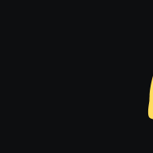

<p align="center">
  
</p>

<h1 align="center">Setline</h1>

<p align="center">
  A fast, offline-first workout tracker that lives on your phone's home screen.<br>
  No accounts, no server, no tracking: your data never leaves your device.
</p>

<p align="center">
  <a href="https://333evan333.github.io/setline/"><strong>Open the app →</strong></a>
</p>

---

## Features

- **Routines & weekly schedule:** build a routine for each gym day, assign routines (or rest) to Mon–Sun, and start today's workout from the home screen.
- **Live workout logging:** exercise cards with `SET · PREVIOUS · WEIGHT · REPS · ✓` rows. Check sets off as you go, add or remove sets and exercises, reorder on the fly.
- **Set types:** Warm-up, Normal, Failure and Drop sets (`W` / `F` / `D` badges). Warm-ups are excluded from volume and PRs.
- **PREVIOUS & auto-fill:** every set shows what you did on that set last time, and each exercise pre-fills from your most recent session.
- **Routine sync:** changes made mid-workout can be saved back to the routine when you finish.
- **Rep targets & timed exercises:** targets as a single number (`8`) or a range (`6–8`). Planks and similar use a time column.
- **History & progress:** full workout history with duration, volume and sets. Per-exercise pages show personal records and charts of estimated 1RM and heaviest weight over time.
- **Body weight tracking:** log by date and view the trend with 1M / 3M / 1Y / All ranges.
- **Units:** lbs or kg globally, with per-exercise overrides. Weights are stored in kg and converted for display, so switching never alters data.
- **Installable & offline:** a Progressive Web App that installs to the home screen and works with no connection.
- **Backup & restore:** export everything to a JSON file and restore it on any device, with a reminder after 14 days without a backup.

## Install

Open **[333evan333.github.io/setline](https://333evan333.github.io/setline/)**, then:

| Device | How |
|---|---|
| iPhone / iPad | Safari → **Share** → **Add to Home Screen** |
| Android | Chrome → **⋮** → **Install app** |
| Desktop | Chrome / Edge → install icon in the address bar |

## Privacy

All data is stored locally in the browser's IndexedDB. Nothing is sent anywhere. There's no backend, analytics or account. Because of that, data doesn't sync between devices. Use **Settings → Export / Import** to move it.

## Tech

Plain HTML, CSS and JavaScript (ES modules). No framework, no dependencies and no build step.

- **Storage:** IndexedDB, through a small promise wrapper
- **Offline:** a service worker that precaches the app shell (cache-first)
- **Charts:** a hand-rolled SVG line chart
- **Routing:** hash-based (`#/home`, `#/routines`, …), so it works on static hosting

## Project structure

```
index.html              App shell and tab bar
manifest.webmanifest    PWA metadata (name, icons, colours)
sw.js                   Service worker: offline cache and updates
css/app.css             All styles; design tokens at the top
js/
  app.js                Router, resume bar, service-worker registration
  db.js                 IndexedDB wrapper
  store.js              Data layer (record shapes documented here)
  workout.js            Workout logic: auto-fill, finish, update routine
  stats.js              Volume, estimated 1RM, personal records
  chart.js              SVG line chart
  backup.js             Export / import and backup reminder
  seed.js               Default plan loaded on first launch
  sets.js, units.js, format.js, ui.js   Shared helpers
  views/                One module per screen
icons/                  App icons (generated by tools/make_icons.py)
tools/                  Dev helpers (not used by the app)
```

## Development

Requires Python 3 to run a local server (any static file server works).

```bash
python tools/serve.py
```

Then open <http://localhost:5173>. On Windows you can also double-click `start-setline.cmd`.

- The dev server disables caching, and the service worker is skipped on `localhost`, so edits show up on reload.
- To test offline and install behaviour locally, use <http://127.0.0.1:5173> instead.
- To regenerate icons, run `python tools/make_icons.py`. It renders `icons/source/twemoji-1f4aa.svg` with headless Microsoft Edge.

## Deploying

The app is served by **GitHub Pages** from the `main` branch root. To ship a change:

1. Bump `VERSION` in `sw.js`. Installed copies use this to detect the update. If you added a file, add it to `APP_FILES` too.
2. Commit and push to `main`.

Pages redeploys within a minute or two. Installed apps then show a **"New version available · Reload"** prompt.

## Customising the default plan

The routines, schedule and exercise library created on first launch are defined in [`js/seed.js`](js/seed.js). The seed only runs on a device with no existing data.

## Credits

The app icon uses the 💪 (flexed biceps) emoji from [Twemoji](https://github.com/jdecked/twemoji) by Twitter, Inc. and other contributors, licensed under [CC-BY 4.0](https://creativecommons.org/licenses/by/4.0/).
